# KairoBarber API

Backend for KairoBarber, a multi-tenant SaaS for Brazilian barbershops. Each shop gets a public storefront with online booking, an admin panel for the team, and an AI visagism consultation: the customer uploads a selfie, a vision model reads the face shape and suggests haircuts, and an image model can render a preview of the chosen cut on the customer's own photo.

Built with NestJS 11, Prisma 5, Postgres, Redis and BullMQ. The paired frontend is a separate Next.js app.

## AI visagism

```mermaid
flowchart LR
    A[Selfie upload<br/>multipart + consent] --> B[Validate photo<br/>size, magic bytes, dimensions]
    B --> C[Atomic quota charge<br/>Postgres UPDATE]
    C --> D[Store in R2<br/>enqueue ai-analysis]
    D --> E[Llama 4 Scout on Groq<br/>structured analysis]
    E --> F[faceShape + description<br/>2-4 haircut suggestions]
    F --> G[Customer picks one<br/>enqueue ai-generation]
    G --> H[gpt-image-1<br/>original photo + cut prompt]
    H --> I[Preview in R2<br/>presigned URL]
```



A consultation runs in two stages, both as BullMQ jobs on the `ai-visagism` queue, so the HTTP request returns right away and the client polls for status.

1. **Upload and checks.** `POST /public/:slug/ai/visagism/consultations` takes the photo in the `photo` field plus a consent timestamp. The service checks the shop's subscription, the file size, the declared MIME type against the real file bytes (`file-type`, JPEG/PNG/WebP only) and a minimum width and height (`image-size`).
2. **Quota.** One atomic `UPDATE ... WHERE used < limit` on the subscription debits the shop's monthly quota. The limit depends on the subscription status: trial and paid plans have separate limits set by env vars. If anything later in the request fails, the quota is refunded and the uploaded photo is deleted.
3. **Analysis.** The worker sends the photo to `meta-llama/llama-4-scout-17b-16e-instruct` on Groq through the Vercel AI SDK (`generateObject`). The output is validated against a zod schema: one of six face shapes, a short description, and 2 to 4 haircut suggestions with an id, name, length, style and a rationale tied to the detected face shape. The system prompt restricts the model to face shape, proportions and visible hair, and forbids comments on ethnicity, skin color, health or age. Photos without a clear face get a flagged placeholder response.
4. **Preview (opt-in).** The customer picks a suggestion and calls `generate-image`. The worker sends the original photo to `gpt-image-1` together with a prompt built from that suggestion (name, style, length, rationale) and an instruction to keep facial features, lighting, angle, background and clothing, changing only the hair, with a realistic result. The output PNG goes to R2 and is served through a presigned URL that lasts 5 minutes.

Other details:

- **Retries and refunds.** Each job retries 3 times with exponential backoff. If the analysis still fails, the consultation is marked `failed` and the quota is refunded.
- **Access by token.** Consultations are public (no login). Creation returns a random view token; only its SHA-256 hash is stored, and every read needs `?token=`.
- **Cost tracking.** Analysis cost is computed from input and output tokens and a configured price per million tokens. Image cost is a configured flat value per image. Both are summed on the consultation and recorded in the audit log.
- **Retention.** Consultations expire after `AI_VISAGISM_RETENTION_DAYS` (7 by default). A daily cron deletes the input and output photos from storage and marks the row `expired`. A monthly cron resets every shop's quota.
- **Swappable provider.** `VisagismProvider` is an interface. `AI_VISAGISM_PROVIDER=aisdk` uses Groq and OpenAI; `console` (the default) uses a deterministic console provider that never calls an external API (used in dev and tests).
- **Rate limits.** Creation and image generation are limited to 3 requests per minute per IP. Status polling is not throttled.

Consultation status goes `queued → processing → completed → generating → generated`, with `failed` and `expired` as end states.

### Endpoints

| Method | Path | |
| --- | --- | --- |
| `POST` | `/public/:slug/ai/visagism/consultations` | Upload photo, start analysis |
| `GET` | `/public/ai/visagism/consultations/:id?token=` | Poll status and analysis |
| `POST` | `/public/ai/visagism/consultations/:id/generate-image?token=` | Generate preview for `suggestionId` |
| `GET` | `/public/ai/visagism/consultations/:id/image?token=` | Presigned URL for the preview |

## The rest of the product

**Multi-tenancy.** Shared database with a `tenantId` column. A Prisma client extension reads the tenant from `AsyncLocalStorage` and adds the `tenantId` filter to queries on tenant-scoped models. Guards handle JWT auth, roles, tenant and subscription state.

**Auth.** JWT access and refresh tokens, argon2 password hashing, email verification, password reset, barber invitations, and a magic-link claim flow for customers. Roles: `saas_owner`, `tenant_owner`, `barber_member`, `customer`.

**Catalog and schedule.** Services, barbers (with service assignment), photo gallery uploaded to Cloudflare R2 through presigned URLs, business hours and barber time off.

**Booking.** Public storefront under `/public/:slug` lists barbers, services and photos, computes availability and creates appointments. The admin side under `/admin/appointments` handles walk-ins, confirm, complete, cancel, no-show and reschedule. Double booking is prevented with a per-barber `pg_advisory_xact_lock` plus `SELECT ... FOR UPDATE` on overlapping appointments. Customers get confirmation and cancellation emails through Resend and can cancel through a magic link up to 2 hours before the appointment.

**Billing.** One plan with a 3-day trial. `BillingProvider` has three implementations: Asaas (primary, PIX, card and boleto), Mercado Pago (legacy) and a console provider for dev. There are no gateway webhooks: state is synced on demand via `POST /admin/billing/sync` and by BullMQ cron jobs (`billing-sync`, `trial-check`) that move expired trials to `past_due` and then to `cancelled` after a grace period. A `past_due` shop can still read in `/admin/*` but cannot write; a `cancelled` shop is blocked except for `/admin/billing`. In both cases the public storefront returns 404.

**SaaS admin.** `/saas/*`, restricted to `saas_owner`: dashboard (MRR, ARR, active tenants, 30-day churn, trial conversion), tenant list and detail, suspend and unsuspend, AI usage per tenant, user search and an append-only audit log.

**Ops.** Structured logs with nestjs-pino, optional Sentry, helmet, global IP throttling with configurable trusted proxy hops, and `/health/live` and `/health/ready`.

## Stack

| | |
| --- | --- |
| Backend | NestJS 11 · TypeScript · Prisma 5 · Postgres 16 |
| Queues | Redis · BullMQ |
| AI | Vercel AI SDK · Groq (Llama 4 Scout) · OpenAI (gpt-image-1) |
| Storage | Cloudflare R2 via `@aws-sdk/client-s3` |
| Billing | Asaas · Mercado Pago |
| Email | Resend |
| Validation | zod · class-validator · joi (env) |
| Tooling | pnpm · Jest · Testcontainers · ESLint · Prettier · Docker |

## Run it locally

Requirements: Node 20 (see `.nvmrc`), pnpm 10+ and Docker with Docker Compose.

```bash
nvm use
corepack enable        # uses the pnpm version pinned in packageManager
pnpm install
cp .env.example .env
docker compose up -d postgres redis
pnpm exec prisma migrate dev
pnpm start:dev
```

The API runs on `http://localhost:3000`. Health check: `GET /health/ready`.

With the default `.env.example`, email, storage, billing and AI all use console providers, so nothing calls an external service. To use the real AI pipeline, set `AI_VISAGISM_PROVIDER=aisdk` and fill `GROQ_API_KEY` and `OPENAI_API_KEY`.

To create the `saas_owner` user, fill `SAAS_OWNER_EMAIL`, `SAAS_OWNER_PASSWORD` and `SAAS_OWNER_NAME` and run `pnpm prisma:seed`. The seed is idempotent and refuses to run in production unless `ALLOW_PROD_SEED=true`.

### Environment variables

See `.env.example` for defaults and comments.

```bash
# App
NODE_ENV=
PORT=
APP_URL=
APP_PUBLIC_URL=
CORS_ORIGINS=
LOG_LEVEL=
TRUST_PROXY_HOPS=

# Database and Redis
DATABASE_URL=
REDIS_URL=

# JWT
JWT_ACCESS_SECRET=
JWT_REFRESH_SECRET=
JWT_ACCESS_TTL=
JWT_REFRESH_TTL=

# Email (console | resend)
EMAIL_PROVIDER=
EMAIL_FROM=
RESEND_API_KEY=

# Auth and throttling
PASSWORD_HASH_TIME_COST=
PASSWORD_HASH_MEMORY_COST=
THROTTLE_TTL=
THROTTLE_LIMIT=

# Storage (console | r2)
STORAGE_PROVIDER=
R2_ACCOUNT_ID=
R2_ACCESS_KEY_ID=
R2_SECRET_ACCESS_KEY=
R2_BUCKET=

# Sentry (optional)
SENTRY_DSN=

# Billing (console | asaas | mercadopago)
BILLING_PROVIDER=
BILLING_TRIAL_DAYS=
BILLING_PAST_DUE_GRACE_DAYS=
BILLING_SYNC_CRON=
BILLING_TRIAL_CHECK_CRON=
BILLING_MRR_CENTS=

# SaaS owner bootstrap (seed only)
SAAS_OWNER_EMAIL=
SAAS_OWNER_PASSWORD=
SAAS_OWNER_NAME=

# Mercado Pago
MP_ACCESS_TOKEN=
MP_PLAN_AMOUNT_CENTS=
MP_BILLING_FREQUENCY=
MP_RETURN_URL=
MP_API_BASE_URL=

# Asaas
ASAAS_API_KEY=
ASAAS_API_BASE_URL=
ASAAS_PLAN_AMOUNT_CENTS=
ASAAS_BILLING_CYCLE=
ASAAS_RETURN_URL=

# AI visagism (console | aisdk)
AI_VISAGISM_PROVIDER=
AI_VISAGISM_TRIAL_QUOTA=
AI_VISAGISM_ACTIVE_QUOTA=
AI_VISAGISM_RETENTION_DAYS=
AI_VISAGISM_CLEANUP_CRON=
AI_VISAGISM_QUOTA_RESET_CRON=
AI_VISAGISM_PHOTO_MAX_BYTES=
AI_VISAGISM_PHOTO_MIN_DIMENSION=
AI_VISAGISM_CONSENT_MAX_AGE_SECONDS=
AI_VISAGISM_GROQ_MODEL=
AI_VISAGISM_GROQ_PRICE_PER_MTOK_CENTS=
AI_VISAGISM_OPENAI_IMAGE_MODEL=
AI_VISAGISM_OPENAI_IMAGE_COST_CENTS=
GROQ_API_KEY=
OPENAI_API_KEY=
```

## Scripts

| Command | |
| --- | --- |
| `pnpm start:dev` | Dev server with watch |
| `pnpm build` | Production build |
| `pnpm start:prod` | Run the build |
| `pnpm test` | Unit tests |
| `pnpm test:cov` | Unit tests with coverage |
| `pnpm test:e2e` | E2E tests (Testcontainers: Postgres and Redis) |
| `pnpm lint` | ESLint |
| `pnpm format` | Prettier |
| `pnpm prisma:migrate:dev` | Create or apply migrations (dev) |
| `pnpm prisma:migrate:deploy` | Apply migrations (prod) |
| `pnpm prisma:seed` | Bootstrap the `saas_owner` user |
| `pnpm prisma:studio` | Prisma Studio |
| `pnpm qa:smoke` / `pnpm qa:ui` | QA scripts in `scripts/` |

## Project layout

```
src/
  modules/
    ai-visagism/    consultations, worker, prompts, providers, quota
    auth/           JWT, refresh, email verification, password reset, claims
    barbers/        barbers, invitations, time off
    billing/        Asaas, Mercado Pago and console providers, sync crons
    catalog/        services and photo gallery
    customers/      customer records
    notifications/  email providers and templates
    public/         storefront: catalog, availability, booking
    saas-admin/     platform dashboard, tenants, AI usage, audit log
    scheduling/     appointments, availability, cancellation
    storage/        R2 and console storage
    tenants/        shop settings and business hours
    health/         liveness and readiness
  common/           guards, decorators, middleware, audit, exceptions
  infra/            Prisma, Redis, BullMQ queue names, logger, Sentry
prisma/             schema, migrations, seed
test/e2e/           E2E specs
docs/superpowers/   design specs and plans
```

## Deploy

The repo ships a multi-stage `Dockerfile` and a `railway.json` that runs `prisma migrate deploy` before starting the app and uses `/health/ready` as the health check.

As a safety net for the cleanup cron, configure an R2 lifecycle rule that deletes objects under `tenants/*/ai-visagism/*` older than 30 days.

The full design lives in [`docs/superpowers/specs/`](docs/superpowers/specs/).
